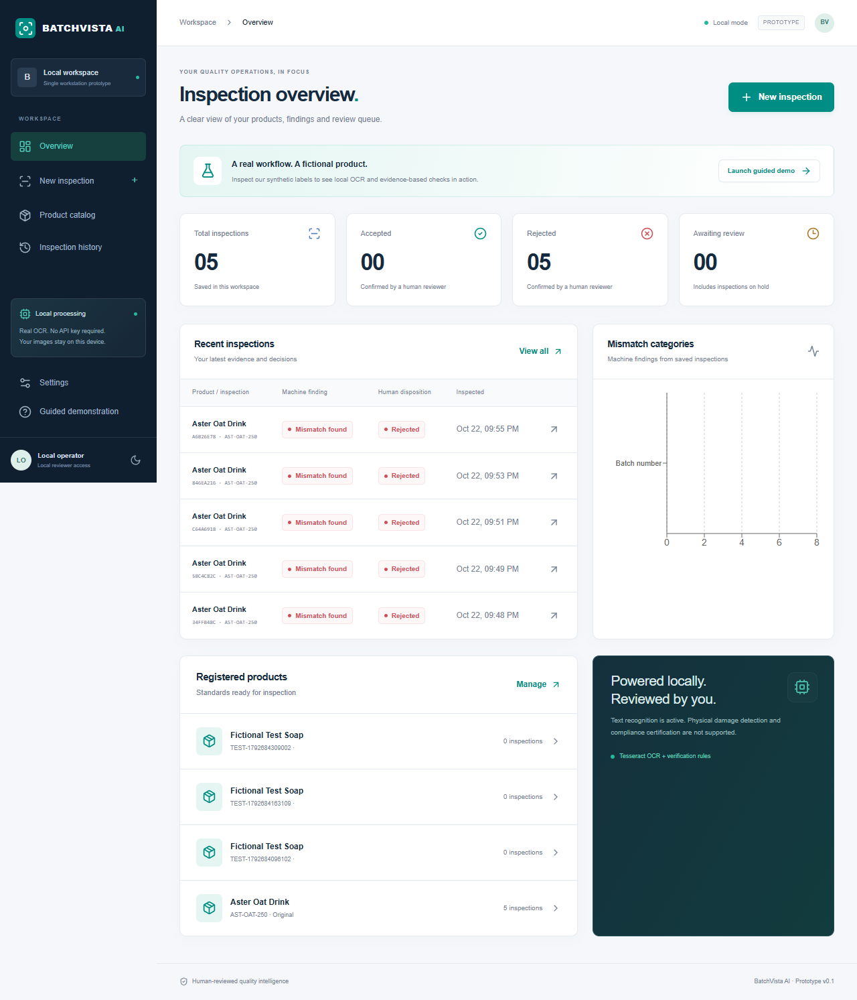

# BatchVista AI

**Industrial Visual Quality Intelligence**

## Vercel public demo update

Two modes are available: the original local workstation and a **device-local public browser demo**. On Vercel, the browser mode runs real Tesseract OCR and the same deterministic checks, with IndexedDB records, evidence, human review and JSON/printable reports. No API key or hosted database is required; workstation APIs are disabled in browser mode.

**Update your Vercel site:** deploy this updated source, use `npm run build` (set by `vercel.json`), set `BATCHVISTA_MODE=browser` for Production/Preview, and redeploy. See [BROWSER_DEMO.md](BROWSER_DEMO.md) for complete instructions. Redeploying an older commit will not include the fix.

Public demo records stay in that browser, without shared staff accounts or cloud backup. Reviewer names are self-declared; reference comparison is manual. First use needs internet for app/OCR assets; offline reload is not guaranteed. Export important records before clearing site data. The workstation retains named accounts and experimental pixel comparison.

The installation and named-account instructions below describe **workstation mode**, unless explicitly stated otherwise.

A working local-first packaging inspection prototype for International AI Builders Congress 2026, Idea to Unicorn, IndustrySphere AI / Quality Vision. Register a standard, inspect an image with real offline OCR, compare evidence, record a human decision, and print a report.

## Camera and production-station update

The application now includes **live camera preview/capture, production batches, named password-protected staff accounts, capture-quality checks and experimental local reference comparison**. These run without a paid API. To connect an actual phone securely, follow [PHONE_SETUP.md](PHONE_SETUP.md). Existing local data is upgraded by migration 002; no reset is required. Back up `data` before upgrading.

### Updated operating workflow

1. Keep stable product identity, variant, quantity and label requirements in **Product catalog**. Upload the approved reference there. Product-form batch/date fields supply the initial/default batch; later product edits do not rewrite an existing production batch.
2. Open **Batch stations** and create a run with its code and dates. Every new UI inspection selects an open batch. Close a finished run to prevent additional inspections; reopening is explicit. Batch summaries count its saved inspections and human dispositions.
3. Select the product and batch in **New inspection**. Use **Open live camera**, capture, and review the preview. **Remove** allows a retake. File upload remains available.
4. Basic resolution, sharpness, brightness and contrast checks provide recapture advice. These are heuristic image-processing measurements, not AI confidence. The server repeats the checks and stores them with the inspection.
5. If a reference exists, optionally enable **Compare approved reference locally (experimental)**. The software resizes similarly framed labels, attempts small translation alignment, and highlights measured grayscale pixel-difference regions. Poor alignment yields uncertainty without boxes. Differences can come from intended batch/date changes or lighting, so they require human assessment and do not automatically produce FAIL. This is not a trained physical-defect classifier.
6. Review OCR, comparison evidence and uncertainty. Confirm the decision, then use **Inspect next package** to retain the last product/batch for repeated capture.

For a reference-comparison demo, use a fresh starter workspace with its seeded reference, or upload `public/fixtures/correct.png` as Aster's approved reference. Inspect **Missing print** with comparison enabled to see measured differences. **Rotated label** demonstrates alignment uncertainty. There are now six synthetic fixtures; none bypass processing.

See the [verified mobile evidence screen](docs/screenshots/mobile-station-evidence.png) and [executed test results](TEST_RESULTS.md).

### Named staff accounts

On localhost, **Settings → Set up named accounts** creates the first administrator. Existing records are retained; anonymous operator sessions are revoked. Thereafter, **Open workspace** prompts for username/password. An administrator creates inspectors (capture/read only), reviewers (standards and decisions) and other administrators. Passwords are salted and hashed; repeated failed logins are throttled. Sign out through Settings. Decisions record the signed-in name.

Default demo access remains available until accounts are configured. Isolated guests are available only from localhost. Phone access requires a named account, an explicitly configured HTTPS origin and a trusted local TLS proxy. No cloud identity service or subscription is required. Password reset/change and user removal screens are not yet implemented. These local identities are not external corporate identity verification.

## First-time installation and user guide

**No API key, cloud account, payment or credit card is required.** Internet is needed for installation; after dependencies are installed, the local inspection workflow needs no external service.

### Guide contents

- [Before installation](#before-installation)
- [Windows: first installation](#windows-first-installation)
- [Ubuntu Linux: first installation](#ubuntu-linux-first-installation)
- [Starting, stopping and restarting](#starting-stopping-and-restarting)
- [Your first inspection](#your-first-inspection)
- [Register and manage your own products](#register-and-manage-your-own-products)
- [Inspect your own photographs](#inspect-your-own-photographs)
- [Understand findings and review evidence](#understand-findings-and-review-evidence)
- [Correct OCR and confirm a human decision](#correct-ocr-and-confirm-a-human-decision)
- [Save reports and export records](#save-reports-and-export-records)
- [Use the dashboard, history and settings](#use-the-dashboard-history-and-settings)
- [Back up and restore your records](#back-up-and-restore-your-records)
- [First-run troubleshooting](#first-run-troubleshooting)
- [Data deletion and reset](#data-and-reset)
- [Optional cloud configuration](#optional-cloud-configuration)
- [Developer verification](#verification)

### Before installation

You need a Windows PC or Ubuntu desktop, a modern browser, **Node.js 24.x** recommended, npm, and the complete project source folder. The project minimum is Node 22.13; verification used Node 24.22. npm is included with Node.

You do **not** need Python, Docker, a separate Tesseract installation, a database account or Supabase credentials. SQLite initializes automatically when you open a workspace. The English OCR model is installed with npm dependencies.

Default operation is local to one workstation. Optional named accounts and a trusted HTTPS proxy enable private-LAN phone access; see PHONE_SETUP.md. This is not a public multi-tenant SaaS deployment.

**Platform verification:** the application has been run and browser-tested on Windows. The Ubuntu instructions below describe the installation approach, but Ubuntu execution has not yet been verified. See [TEST_RESULTS.md](TEST_RESULTS.md).

### Windows: first installation

#### Step 1 — Install Node.js

1. Visit the official [Node.js download page](https://nodejs.org/en/download).
2. Choose **Node.js 24.x**, Windows, and the installer matching your computer. Most Windows PCs use x64.
3. Run the installer with npm included and the default PATH option enabled.
4. Close and reopen PowerShell or Windows Terminal.
5. Check the installation:

```powershell
node --version
npm.cmd --version
```

The first command should print `v24...`; the second should print an npm version. If a compatible Node version is already installed, you may use it.

#### Step 2 — Extract the project

If you received a ZIP, right-click it and choose **Extract All**. Open the extracted folder containing `package.json`. Do not run the project inside the ZIP. If you received a Git repository URL, clone that actual URL instead; this guide does not assume a public repository exists.

A convenient location is `C:\Projects\batchvista-ai`. If copying from another computer, copy the source files but **do not reuse its `node_modules` or `.next` folders**. Dependencies and builds must be created on this machine. Copy `data` only if you intentionally want the previous records.

#### Step 3 — Open PowerShell in that folder

In File Explorer, open the project folder and choose **Open in Terminal**, or enter your actual path:

```powershell
cd "C:\Projects\batchvista-ai"
Get-ChildItem package.json
```

On the original development computer, the path is:

```powershell
cd "C:\Users\jesan\OneDrive\Desktop\batchvista-ai"
```

Use the path that exists on your PC. If `package.json` is not found, change to the correct folder before continuing.

#### Step 4 — Install and start

Run these commands one at a time, waiting for each to finish. Address any error before continuing.

```powershell
npm.cmd ci
npm.cmd run fixtures
npm.cmd run dev
```

`ci` installs the locked dependencies, including the OCR model. `fixtures` generates six fictional test-label images; it does not invent inspection results. `dev` starts the server.

When the terminal shows **Ready**, open [http://127.0.0.1:3000](http://127.0.0.1:3000). **Keep the terminal open while using the software.** If a different port appears in the terminal's Local URL, use that URL instead.

Using `npm.cmd` avoids PowerShell's `npm.ps1` execution-policy error without changing your security policy. Plain `npm` is also fine if it already works on your PC.

### Ubuntu Linux: first installation

Use a normal user account and Bash. Use `sudo` only for the operating-system package commands below, **not** for npm or starting BatchVista.

#### Step 1 — Install download tools and fonts

```bash
sudo apt update
sudo apt install -y curl ca-certificates fontconfig fonts-liberation
```

Fonts are used to generate the synthetic test labels. A separate OCR service is unnecessary.

#### Step 2 — Install Node.js 24

The official [nvm instructions](https://github.com/nvm-sh/nvm#installing-and-updating) describe its per-user installer. Download and inspect the pinned installer before running it:

```bash
curl -fsSL https://raw.githubusercontent.com/nvm-sh/nvm/v0.40.8/install.sh -o /tmp/batchvista-nvm-install.sh
less /tmp/batchvista-nvm-install.sh
```

Press `q` to leave the viewer, then run:

```bash
bash /tmp/batchvista-nvm-install.sh
source ~/.bashrc
nvm install 24
nvm alias default 24
nvm use 24
node --version
npm --version
```

If `nvm` is not found, close and reopen Terminal, then retry `nvm use 24`. An existing compatible Node installation may be used instead. Avoid replacing another project's Node setup without checking its requirements.

#### Step 3 — Open the source folder

Extract the supplied ZIP with Ubuntu's archive manager, or clone the actual repository URL you received. For example, place the extracted folder at `~/Projects/batchvista-ai`:

```bash
cd ~/Projects/batchvista-ai
ls package.json
```

Adjust the path to your folder. Linux paths are case-sensitive. Do not copy Windows `node_modules` or `.next` into this installation.

#### Step 4 — Install and start

```bash
npm ci
npm run fixtures
npm run dev
```

Wait for **Ready**, keep the terminal open, and open [http://127.0.0.1:3000](http://127.0.0.1:3000) in the browser **on that Ubuntu computer**. Use the terminal's actual Local URL if it chooses another port.

This guide assumes an Ubuntu desktop. If Ubuntu is a VM or remote machine, Windows's `127.0.0.1` is not automatically the Ubuntu server. Private phone access requires the separate PHONE_SETUP.md configuration; public hosting is not configured.

### Starting, stopping and restarting

You only install dependencies once, unless they change. You do not need to regenerate fixtures every time.

**Windows PowerShell:**

```powershell
cd "C:\Projects\batchvista-ai"
npm.cmd run dev
```

**Ubuntu:**

```bash
cd ~/Projects/batchvista-ai
nvm use 24
npm run dev
```

Use your real project path. Skip `nvm use 24` if you did not install through nvm.

- To open the application, use the Local URL printed by the terminal.
- To stop it, focus the terminal and press **Ctrl+C**. Confirm `Y` if Windows asks to terminate the batch job.
- To restart, run the start command again. Saved database records remain.
- Closing the browser does not stop the server or erase records.
- Closing the server terminal stops the software; an old browser tab cannot restart it.

To choose port 3100 explicitly:

```bash
npm run dev -- --port 3100
```

On Windows use `npm.cmd` if needed. Then open [http://127.0.0.1:3100](http://127.0.0.1:3100). An earlier preview tab using port 3100 will only work if the server is actually running there. Keep using the same hostname during a session; `localhost` and `127.0.0.1` have separate browser cookies.

For an optional optimized local build, stop development mode, then run `npm run build` followed by `npm start`. On Windows use `npm.cmd run build` and `npm.cmd start`. For a different production-mode port, use `npm start -- --port 3100`. Rebuild after source changes. This still runs locally; it is not public deployment.

### Your first inspection

Use the fictional **Aster Oat Drink** product to learn the workflow before uploading your own images.

| Landing-page button       | What it opens                                                                                                                      |
| ------------------------- | ---------------------------------------------------------------------------------------------------------------------------------- |
| **Try a real inspection** | The local operator workspace directly in the guided inspection flow. Use this for the full demo, including a final human decision. |
| **Open workspace**        | The local operator dashboard and its saved records.                                                                                |
| **Explore as guest**      | A new isolated fictional workspace. Guests can inspect but cannot approve dispositions.                                            |

Before account setup, the local demonstration needs no password. Once an administrator enables named accounts, operator access requires sign-in. New workspaces receive the fictional starter product. Its reference image is seeded when the synthetic fixture is available. Opening a new guest workspace does not transfer previous guest records into it or into the operator workspace.

1. Click **Try a real inspection**.
2. Select **Aster Oat Drink · AST-OAT-250** under **Product specification**.
3. Select the open **Production batch** `BV-2026-042`. Check the expected batch, expiry and quantity displayed below the selectors.
4. Choose the synthetic **Wrong batch** label.
5. Leave optional Gemini unchecked; it is unavailable unless separately configured.
6. Click **Run inspection** and wait for processing. Do not repeatedly submit while it is running.
7. The saved result opens in **Evidence & review**. Find **Batch number**: expected `BV-2026-042`, observed `BV-2026-099`.
8. Examine the image, then choose **Reject** under **Final disposition**.
9. Enter a rationale such as “Verified printed batch BV-2026-099 against approved BV-2026-042. Reject for relabeling.”
10. Click **Confirm human decision**, check the audit trail, and click **Open report**.
11. Use **Print / Save PDF** to save or print the record.

The result comes from actual image pixels. OCR has a 90-second limit; a failure or unreadable image is recorded with uncertainty, not a fabricated successful extraction.

Try the other examples using **New inspection**, keeping Aster selected:

| Synthetic example  | What it demonstrates                                                                           |
| ------------------ | ---------------------------------------------------------------------------------------------- |
| **Approved label** | Expected supported text checks match: PASS recommendation. Human acceptance is still required. |
| **Wrong batch**    | Readable batch mismatch: FAIL recommendation.                                                  |
| **Wrong expiry**   | Readable expiry mismatch: FAIL recommendation.                                                 |
| **Low resolution** | Unreadable evidence: REVIEW, without invented text or boxes.                                   |

These are fictional tests, not an industrial accuracy benchmark. See [DEMO_SCRIPT.md](DEMO_SCRIPT.md) for a three-minute presentation.

### Register and manage your own products

Open **Product catalog** in the sidebar, then **Register product**. On small screens, open the menu button first.

| Field                                          | What to enter                                                                                                  |
| ---------------------------------------------- | -------------------------------------------------------------------------------------------------------------- |
| **Product name**                               | Required expected printed name.                                                                                |
| **SKU**                                        | Required internal identifier, unique in the workspace. It is catalog metadata, not an OCR-checked label field. |
| **Variant**                                    | Optional expected variant, such as `Original`; leave blank if not checked.                                     |
| **Batch number**                               | Required exact expected batch, such as `BV-2026-042`.                                                          |
| **Manufacturing date**                         | Optional date; the supported printed format is `YYYY-MM-DD`.                                                   |
| **Expiry date**                                | Optional date; must follow manufacturing date if both are provided.                                            |
| **Net quantity**                               | Required expected amount including unit, such as `250 ml`.                                                     |
| **Mandatory label text**                       | One phrase per line, up to 12 phrases. Leave empty if none are required.                                       |
| **Require human physical / visual inspection** | Adds a check that cannot pass automatically and needs human assessment.                                        |

Click **Save specifications**, correcting any validation messages. Comparisons normalize case and punctuation; they do not perform unit conversion, regulatory interpretation or fuzzy equivalence. Use quantities and wording consistent with the printed label.

On the product card, click **Add approved reference** to upload a clear approved PNG/JPEG/WebP image. Wait for its preview. **Replace approved reference** updates it later. References support manual comparison and an opt-in experimental local pixel comparison. Neither certifies physical package integrity.

Use **Edit specifications** for updated product requirements. Use **Batch stations → Create batch** for a new batch code or production dates; editing the product does not rewrite an existing batch. Existing inspections retain their product/specification/reference snapshot; edits apply to new inspections. Do not change the expected specification merely to make a failed image pass. Correct a genuine OCR error in the review instead.

The trash button deletes a product after confirmation. A product with saved inspections cannot be deleted until those inspections are removed.

### Inspect your own photographs

1. Register or update the correct product first.
2. Open **New inspection** and explicitly select that product.
3. Browse for an image or drag it into the upload area.
4. Verify the preview; use **Remove** if you selected the wrong file.
5. Keep cloud processing off for private factory images.
6. Click **Run inspection**, inspect the evidence, and record a human decision.

Uploads must be **PNG, JPEG or WebP**, no larger than **10 MB** and **24 megapixels**. PDFs, videos, SVG, HEIC and animated images are not supported; convert them to a supported still image first.

Photograph the complete label straight on, with good lighting and sharp focus. Avoid glare, skew, tiny text and background clutter. Explicit English field labels work best, for example:

```text
PRODUCT: Aster Oat Drink
VARIANT: Original
BATCH: BV-2026-042
MFG: 2026-10-01
EXP: 2027-04-01
NET: 250 ml
Store in a cool dry place
Shake well before use
```

**Open live camera** provides a real preview and capture/retake flow, requesting the rear camera when available. **Capture with device camera** remains a file/camera-picker alternative. Phones require the trusted HTTPS setup in PHONE_SETUP.md; localhost on a phone refers to the phone, not the PC.

Stored images are rotated to the proper orientation, stripped of metadata, converted to PNG and resized to at most 2400 pixels per side when needed. The retained evidence is this normalized image; raw upload bytes and EXIF are not retained.

### Understand findings and review evidence

| Machine recommendation | Display wording | Meaning                                                                                                      |
| ---------------------- | --------------- | ------------------------------------------------------------------------------------------------------------ |
| **PASS**               | Checks passed   | Every mandatory supported check has readable matching evidence. This does not automatically accept the item. |
| **FAIL**               | Mismatch found  | At least one required field has a clear readable mismatch. Other checks may still be uncertain.              |
| **REVIEW**             | Needs review    | Evidence is missing, ambiguous, unreadable or unsupported, with no established mismatch.                     |

Each comparison shows expected and observed values, status and evidence. Missing mandatory text in OCR is **uncertain**, not proof that the printed phrase is absent. Ambiguous date formats also need review.

- **Inspection image:** view the stored image. Toggle **Actual OCR word boxes** to show real detected text coordinates. These boxes do not localize physical defects.
- **Approved reference:** view the reference captured for this inspection, if present, for manual comparison.
- **OCR text:** view the original extracted text, including recognition errors. No readable text is reported explicitly when extraction fails.

Read all uncertainty warnings. Optional AI observations appear separately and do not set the deterministic recommendation. A result never certifies safety, compliance, authenticity, seal integrity or freedom from all defects.

### Correct OCR and confirm a human decision

Only a local demo operator or signed-in reviewer/administrator can confirm a disposition. Inspectors have capture/read access only. Guests must open the operator workspace and run an inspection there; their existing guest records are not transferred.

If OCR misread text that you can clearly see in the image:

1. Expand **Correct a transcription**.
2. Enter corrected values only for affected fields. Blank inputs leave existing values unchanged; they do not erase them.
3. Select a disposition and explain the correction in the rationale.
4. Click **Confirm human decision**.

Corrections cover name, variant, batch, dates and quantity. Mandatory phrases and physical requirements still need manual assessment. Original OCR and the initial recommendation are preserved. Reviewed comparisons are recomputed and corrections are included in the audit trail. Later reviews retain previous corrections unless replaced.

| Human disposition             | Use                                                                         |
| ----------------------------- | --------------------------------------------------------------------------- |
| **Accept after human review** | You have checked sufficient evidence to accept the item under your process. |
| **Reject**                    | You confirmed an unacceptable mismatch or concern.                          |
| **Hold for further review**   | You need a clearer image, another inspection or further assessment.         |

The rationale must contain at least eight characters. Explain any override of a machine finding. You can add another decision later; the latest becomes current while earlier decisions remain visible. “Local operator” is not verified corporate identity or a digital signature.

### Save reports and export records

From a saved inspection, click **Open report**. The report contains its product snapshot, ID, image, OCR, comparisons, method, decision, timestamps, audit trail and limitations.

Click **Print / Save PDF**, choose your browser's PDF destination or printer, and save/print. Destination names vary by browser and OS. **Back to evidence** returns to review. A report opened before review states that no human decision is recorded; do not present it as approved.

**Export JSON** on the evidence page downloads the structured inspection. It contains image identifiers, not the image files themselves. JSON and PDF exports are not complete database backups. Deleting an inspection does not remove previously downloaded exports.

### Use the dashboard, history and settings

**Overview** shows actual saved records: total inspections, human-accepted/rejected counts, awaiting review (including hold), original machine mismatch categories, recent inspections and product counts. One inspection may have multiple mismatch findings. Missing OCR evidence is not counted as a confirmed defect. There are no invented performance metrics.

**Inspection history** lets you search product name, SKU, batch or inspection ID; filter by product and human disposition; sort newest/oldest first; and open evidence using the product name or open icon. Hold has its own history filter even though it is included in the dashboard's awaiting-review count. Wide tables scroll horizontally on smaller screens.

After reloading the browser, you may see the landing page again. Choose **Open workspace** and open history; records persist in SQLite.

**Settings** provides:

- **Appearance:** light/dark themes, also switchable from the sidebar. Preferences are browser-local.
- **Product defaults:** require human visual review for new products; existing products stay unchanged.
- **Processing providers:** local OCR and optional Gemini availability. Keys are server configuration, not browser inputs.
- **Data & access:** data-handling information and switching between operator and a new isolated guest workspace.
- **Audit history:** click **Load audit trail** to see product changes, inspections, decisions and deletions.

Sessions expire after 24 hours. Reopen the workspace if needed. Browser cookies/theme settings can differ across browsers and hostnames, while operator records stay in the server's data directory.

### Back up and restore your records

The default database is `data/batchvista.sqlite`; private images are under `data/images/`. SQLite may also create `-wal` and `-shm` files.

Stop **all** BatchVista server processes using the database, then copy the entire `data` directory, including sidecars. Also preserve intentional `.env.local` configuration securely. Start again after copying completes.

Windows backup, from the project directory:

```powershell
$backupPath = Join-Path $env:USERPROFILE ("BatchVista-backup-" + (Get-Date -Format "yyyyMMdd-HHmmss"))
Copy-Item -LiteralPath .\data -Destination $backupPath -Recurse
Write-Output $backupPath
```

Ubuntu backup, from the project directory:

```bash
backup_path="$HOME/BatchVista-backup-$(date +%Y%m%d-%H%M%S)"
cp -a ./data "$backup_path"
printf '%s\n' "$backup_path"
```

To restore: stop the app, preserve the current `data` directory under another name, and copy your backup back as `data` beside `package.json`. Do not merge a backup into a running database. For another OS, install dependencies fresh with `npm ci`, then restore the data with compatible application code; do not transfer `node_modules`.

If you configured `BATCHVISTA_DATA_DIR`, back up that directory instead and keep it outside `public/`. There is no at-rest encryption or automatic cleanup. Clearing browser cookies does not erase server records. See [Data and reset](#data-and-reset) for deletion details.

### First-run troubleshooting

| Problem                                           | Resolution                                                                                                                                       |
| ------------------------------------------------- | ------------------------------------------------------------------------------------------------------------------------------------------------ |
| An old localhost/3100 tab says connection refused | Start the server and use its printed Local URL. A browser tab cannot start it for you.                                                           |
| `node` or `npm` not recognized                    | Install Node 24 and reopen the terminal. With Ubuntu/nvm, run `source ~/.bashrc` and `nvm use 24`.                                               |
| PowerShell blocks `npm.ps1`                       | Use `npm.cmd`; no execution-policy change is necessary.                                                                                          |
| `package.json` not found / ENOENT                 | Change into the extracted source folder containing that file.                                                                                    |
| npm network/certificate error                     | Check internet, firewall/proxy and certificates, then retry. Do not disable TLS verification.                                                    |
| Ubuntu permission errors                          | Use a user-owned project directory and nvm. Do not use `sudo npm`; fix ownership or extract a fresh user-owned source copy.                      |
| Native module error after copying across OSs      | Do not reuse copied `node_modules`. Install fresh with `npm ci` on the destination, using the correct Node architecture.                         |
| SQLite unavailable                                | Check Node version; use 24.x. Some versions may emit an experimental warning.                                                                    |
| Port 3000 busy                                    | Use the dev server's alternative Local URL or explicitly pass `-- --port 3100`. Do not kill an unknown process.                                  |
| Production build missing                          | Run `npm run build` before `npm start`, or use `npm run dev`.                                                                                    |
| Local-only or cross-origin error                  | Visit the same local hostname and port directly, without external proxy/tunnel access.                                                           |
| No OCR model / fixtures                           | Run `npm ci` for the model or `npm run fixtures` for the synthetic PNGs.                                                                         |
| Fontconfig warning                                | On Ubuntu install the listed fonts and ensure the normal user's cache is writable. Inspect generated images; supplied fixtures can also be used. |
| REVIEW from a blurry photo                        | Improve light/focus/resolution, include the full label and inspect the source before correcting text.                                            |
| Worker busy or timed out                          | Wait, then submit a clearer/smaller image as a new inspection. The uncertain original record remains.                                            |
| Cannot approve                                    | Use operator mode and enter a rationale of at least eight characters. Guest records cannot be approved.                                          |
| Old inspection has no reference                   | Add a reference before a new inspection. Historical snapshots are not retroactively updated.                                                     |
| Unexpected empty dashboard                        | Check whether you opened a new guest workspace, switched data directories, or reset data.                                                        |
| Product deletion refused                          | It has saved inspections; remove those first only if that is intended.                                                                           |
| Gemini unavailable                                | Normal without configuration. Continue with local OCR; do not activate billing to fix a quota error.                                             |

## Quick start — no API key, account or credit card

Requires Node.js 22.13+ (tested on 24.22), npm, and a modern browser. Installation needs internet to download open-source packages. After installation, local inspections require no network service.

```sh
npm ci
npm run fixtures
npm run dev
```

Open **http://127.0.0.1:3000**. Choose **Try a real inspection** for the guided operator demonstration, or **Open workspace** for the dashboard. Guest mode uses a separate fictional workspace and cannot approve dispositions.

For a production-mode local server:

```sh
npm run build
npm start
```

Next.js intentionally binds to loopback. Named accounts and the documented HTTPS proxy support private-LAN stations. Do not expose anonymous demo access or publish this as a hardened multi-tenant SaaS.

## What works

- Responsive landing page, dashboard, light/dark themes and guided demo.
- Product create/edit/delete, validated specifications, and private reference-image uploads.
- PNG/JPEG/WebP upload or mobile camera file capture; 10 MB and 24 megapixel limits.
- Bundled English Tesseract neural OCR, real word bounding boxes, deterministic field checks.
- Six actual synthetic PNG fixtures: correct, wrong batch, wrong expiry, unreadable, missing print and rotated.
- SQLite persistence, product snapshots, original OCR, append-only human review entries, corrections and audit events.
- Search/filter/sort history, actual-data counts and mismatch chart, evidence viewer, JSON export, printable report / browser Save as PDF.
- Optional server-only Gemini observations with per-image consent; disabled by default.

No invented inspection results, confidence probabilities, customers or cost-savings claims. Charts start empty and derive only from saved inspections. OCR recognition scores are not product compliance scores.

## Verified interface

The screenshot below shows real saved inspections of the fictional test labels, created during browser testing.



[Mobile dashboard](docs/screenshots/dashboard-mobile.png) · [Inspection evidence and report](docs/screenshots/inspection-report.png)

## Three-minute demo

1. Click **Try a real inspection**. Keep fictional Aster Oat Drink selected.
2. Choose **Wrong batch**, then **Run inspection**. The server reads its pixels using the installed English OCR model.
3. Show expected `BV-2026-042` versus observed `BV-2026-099`, original image and actual OCR boxes.
4. Choose **Reject**, enter a rationale and **Confirm human decision**.
5. **Open report**, then **Print / Save PDF**. Show the audit trail.
6. Repeat with **Low resolution** to demonstrate uncertainty rather than a fabricated defect. See [DEMO_SCRIPT.md](DEMO_SCRIPT.md).

## Data and reset

Default private storage: `data/batchvista.sqlite` and `data/images/`. Back up the whole directory with the server stopped, including SQLite sidecar files if present. Inspection deletion removes its reviews and image; a metadata-only deletion audit event remains. Reference uploads are retained to preserve historical snapshots. There is no encrypted storage or automated retention schedule.

Stop the server, then run `npm run reset -- --confirm`. This **moves**, rather than deletes, the default data directory to `data-backup-<timestamp>`. Restart and open a workspace to create fresh data. Backups contain images and private records; remove them manually if you require complete erasure. Custom data directories must be reset manually. Do not run reset against a running server.

On Windows, use `npm.cmd run reset -- --confirm` if needed. The reset helper does not automatically load `.env.local`, so if Next.js uses a custom `BATCHVISTA_DATA_DIR` there, manage that directory manually rather than relying on the helper. To delete a single inspection, open its evidence page and choose **Delete inspection & image**, then confirm. Exported reports and backups are unaffected. Retained references, guest workspaces and unused assets have no automatic cleanup.

## Optional cloud configuration

Copy `.env.example` to `.env.local` only if needed. Local processing works without this file. Gemini requires all of:

On Windows, create/edit the file with:

```powershell
Copy-Item .env.example .env.local
notepad .env.local
```

On Ubuntu:

```bash
cp .env.example .env.local
nano .env.local
```

If `.env.local` already exists, edit it instead of overwriting it. Configure these optional settings:

- `GEMINI_API_KEY` belonging to a project **without billing activated**.
- `GEMINI_FREE_TIER_ACK=true` after verifying that account's free-tier eligibility.
- Optional `GEMINI_MODEL` (default `gemini-2.5-flash`). Availability can change.
- Checkbox consent on each inspection confirming fictional, non-sensitive test data.

Restart the server after changing environment values, then check provider availability in **Settings**. To use it on an inspection, enable the Gemini checkbox and the fictional-data consent checkbox. Keep it disabled for private industrial images. Optional observations appear separately from OCR and do not decide the recommendation. To disable it, clear the key or set `GEMINI_FREE_TIER_ACK=false`, then restart. Keep keys out of Git, screenshots and shared files.

The app cannot inspect Google billing status and cannot guarantee that an arbitrary key is free. Never provide a billing-enabled project. There is no paid fallback, automatic billing activation, or retry to a paid model. No cloud call was used for this implementation's tests. See [AI_USAGE.md](AI_USAGE.md).

## Verification

```sh
npm run lint
npm run typecheck
npm test
npm run build
npm run test:e2e
npm run test:station
```

Ordinary users do not need these checks to inspect images. On a fresh checkout, if type checking reports missing generated Next.js types, run the build first. Browser tests create fictional records in the local database; use a separate test checkout or back up your data if you do not want test records mixed in.

The station test starts the production build on port 3102 with a fresh isolated test database and a virtual camera. Run `npm run build` first and leave port 3102 free. It verifies named accounts, camera shutdown, batch selection, real local reference differences and inspector permissions.

Playwright defaults to installed Microsoft Edge. On Ubuntu without Edge, remove the `channel: "msedge",` line from the `use` section in both `playwright.config.ts` and `playwright.station.config.ts`, then install Playwright Chromium and its system dependencies:

```bash
npx playwright install --with-deps chromium
npm run test:e2e
```

Browser installation needs internet and OS dependency installation may request administrator privileges. It is unnecessary for ordinary application use. These Ubuntu test instructions have not been executed in this Windows environment.

Tests use port 3000 by default. To test an **already-running** server on port 3100:

```powershell
# Windows PowerShell
$env:PLAYWRIGHT_BASE_URL = "http://127.0.0.1:3100"
npm.cmd run test:e2e
```

```bash
# Ubuntu Bash
PLAYWRIGHT_BASE_URL=http://127.0.0.1:3100 npm run test:e2e
```

This variable does not change the development server's launch port; start the alternative server yourself first. See [TEST_RESULTS.md](TEST_RESULTS.md) for actual completed verification.

## Troubleshooting

- **OCR model missing:** run `npm ci`; `node_modules/@tesseract.js-data/eng/4.0.0_best_int/eng.traineddata.gz` must exist. OCR never downloads a model at inspection time.
- **Unreadable photograph:** crop to the complete label, improve lighting/focus and avoid glare. The parser supports explicit English field labels and ISO dates; unsupported layouts need human correction.
- **Local workstation only error:** use `http://127.0.0.1:3000` or localhost directly. Requests through external hosts are intentionally blocked.
- **Node SQLite unavailable:** use Node 22.13+; tested with Node 24.22. The runtime may emit an experimental SQLite warning.
- **Port busy:** stop the old process. The browser tests expect port 3000.
- **Fontconfig warning during fixtures:** the fixture images can still generate; inspect the output. The original tested fixtures are committed under `public/fixtures`.
- **Session expired:** reopen the local workspace; records persist. Guest sessions have independent organization data.

Architecture, limitations and deployment boundaries are documented in [ARCHITECTURE.md](ARCHITECTURE.md), [LIMITATIONS.md](LIMITATIONS.md), and [DEPLOYMENT.md](DEPLOYMENT.md).
